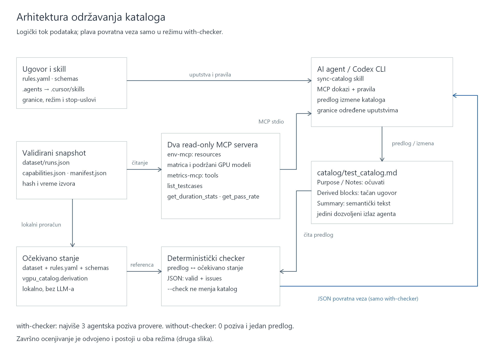
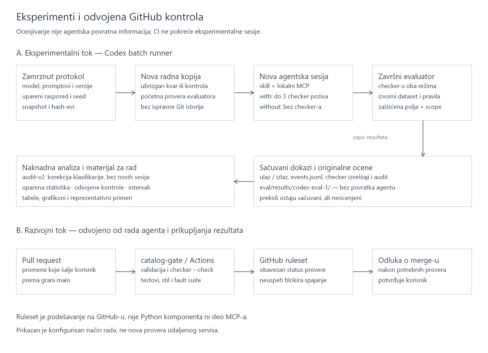

# Arhitektura sistema — materijal za diplomski rad

Pripremljena su dva logička prikaza, prema pregledanom kodu projekta.
To nisu snimci živog izvršavanja niti automatski izveden graf svih programskih
zavisnosti. Prva slika objašnjava održavanje kataloga, a druga razdvaja
eksperimentalno ocenjivanje od GitHub kontrole izmena.

## Pripremljene slike

1. Arhitektura održavanja: [PNG](evidence/architecture-v1/maintenance.png),
   [SVG](evidence/architecture-v1/maintenance.svg) i
   [Mermaid izvor](evidence/architecture-v1/maintenance.mmd).
2. Eksperimenti i odvojeni CI tok:
   [PNG](evidence/architecture-v1/evaluation-and-ci.png),
   [SVG](evidence/architecture-v1/evaluation-and-ci.svg) i
   [Mermaid izvor](evidence/architecture-v1/evaluation-and-ci.mmd).

PNG slike imaju dvostruku rezoluciju i 300 dpi oznaku. Za štampu je poželjan
SVG; za drugi, širi dijagram koristiti pejzažnu stranu ako bi se oznake pri
smanjenju na širinu tekstualne kolone teško čitale. Brojeve slika prilagoditi
konačnoj numeraciji rada.

## 1. Komponente i njihove odgovornosti

| Komponenta | Odgovornost | Konkretna implementacija |
| --- | --- | --- |
| Snapshot i validacija | Učitavanje podataka, provera šema, identiteta i hash-eva | `vgpu_catalog.snapshot`, `vgpu_catalog.validation`, `dataset/manifest.json` |
| env-mcp | Read-only resursi za kompatibilnost GPU modela i zahteve testova | `env_mcp.server`, `env_mcp.service` |
| metrics-mcp | Read-only alati za trajanje, broj merenja i prolaznost | `metrics_mcp.server`, `metrics_mcp.service` |
| Ugovor i skill | Pravila izvođenja vrednosti, granice izmena i uslovi zaustavljanja | `rules.yaml`, `schemas/`, `.agents/skills/sync-catalog/`, `.cursor/skills/sync-catalog/` |
| Agent | Prikupljanje dokaza, predlog i dozvoljene izmene kataloga | Codex CLI pokrenut iz runner-a; skill određuje radni postupak |
| Katalog | Ljudski, semantički i izvedeni sadržaj u jednom Markdown fajlu | `catalog/test_catalog.md` |
| Deterministički proračun | Izračunavanje očekivanih izvedenih vrednosti bez LLM-a | `vgpu_catalog.derivation.derive_catalog` |
| Checker | Poređenje stvarnog i očekivanog sadržaja, JSON izveštaj | `catalog_check.checker.check_catalog`, `catalog_check.cli` |
| Eksperimentalni runner | Izolovanje konteksta, ubrizgavanje grešaka, pokretanje i ocenjivanje | `vgpu_eval.codex_batch`, `vgpu_eval.faults`, `vgpu_eval.runs` |
| Naknadna analiza | Dokumentovana korekcija auditora i statistika sačuvanih ocena | `vgpu_eval.codex_reanalysis`, `vgpu_eval.results_figures` |
| CI i zaštita grane | Provera predloženih izmena i uslov za spajanje | `.github/workflows/catalog-ci.yml` i zasebno podešeni GitHub ruleset |

Moduli su u `src/`. [Manifest slika](evidence/architecture-v1/manifest.json)
navodi tačne pregledane putanje, commit i njihove hash-eve. Sadržaj skupa i
istorijski zamrznuti eksperimentalni protokol nisu menjani izradom dijagrama.

## 2. Održavanje kataloga — predlog teksta za rad

Arhitektura razdvaja pristup izvorima, agentsko predlaganje izmena i
determinističku proveru. Izvorni skup je validirani, vremenski fiksirani
snapshot sa podacima o izvršavanjima, mogućnostima GPU modela i manifestom.
Manifest obezbeđuje identitet i referentno vreme izvora, tako da se vrednosti
ne izvode iz trenutnog sistemskog vremena.

Agent pristupa dokazima preko dva lokalna MCP servera koji koriste stdio
transport. env-mcp izlaže matricu mogućnosti i resurse podržanih GPU modela za
test. metrics-mcp izlaže listu testova, statistike trajanja i statistike
prolaznosti. Oba servisa učitavaju validirani snapshot; i metrics-mcp koristi
identifikatore testova i GPU modela iz capability podataka. Razdvajanje servera
predstavlja razdvajanje odgovornosti, ne dva nezavisna fizička izvora podataka.
Kompatibilnost se ne zaključuje iz prisustva merenja.

Skill određuje redosled rada i granice dozvoljenih izmena, a rules.yaml i šeme
određuju ugovor izvedenih podataka. Codex skill je omotač koji upućuje na
kanonski postupak u `.cursor/skills/sync-catalog/SKILL.md` i definiše
eksperimentalni režim. Jedini dozvoljeni izlaz agenta je izmena
`catalog/test_catalog.md`. Purpose i Notes moraju biti očuvani. Izvedeni
blokovi imaju strogo određen oblik i vrednosti; Summary može biti semantički
ažuriran u granicama pravila, ali njegova potpuna semantička ispravnost nije
deterministički potvrđena.

Checker očekivane vrednosti računa lokalno iz dataset-a i pravila i proverava
predlog kataloga. On ne poziva model niti za tu proveru mora da pristupa MCP-u.
Režim `--check` ne menja katalog i vraća JSON sa `valid` i listom `issues`.
Polja `expected` i `actual` dostupna su za pojedine probleme; ne treba
pretpostaviti da su popunjena za svaku vrstu greške.

U režimu with-checker agentu je dozvoljen prvi poziv provere i najviše dve
dodatne fokusirane provere, ukupno tri. Pozitivan rezultat završava petlju.
Strukturne greške i drugi uslovi iz skill-a mogu dovesti do zaustavljanja i
zahteva za ljudski pregled. U režimu without-checker agent pravi jedan predlog
bez pokretanja checker-a i bez njegovih izlaza. Checker-ov mehanički `--write`
režim postoji u programu, ali je zabranjen agentskim eksperimentalnim postupkom
i zato nije prikazan kao veza koja menja katalog.

Predlog potpisa:

> Slika X. Logička arhitektura održavanja vGPU test kataloga. Agent dobija
> dokaze preko read-only MCP interfejsa i uređuje katalog prema skill-u i
> pravilima. Checker lokalno računa očekivano stanje; njegova povratna veza
> agentu dostupna je samo u režimu with-checker.



## 3. Eksperimentalni tok — predlog teksta za rad

Eksperimentalni runner prvo proverava i beleži protokol, verzije, model,
promptove, raspored i hash-eve izvora. Za svaki pokušaj priprema novu radnu
kopiju, ubrizgava odgovarajući kvar ili ostavlja čistu kontrolu i nezavisno
proverava početno stanje. Jedini početni commit u radnoj kopiji sadrži dati
ulaz, pa Git istorija ne pruža ispravnu verziju pre ubrizgavanja greške. Agent
se pokreće u novoj ephemeral sesiji, bez kopiranja ranijih rezultata i razgovora.

Po završetku sesije runner proverava izlaz originalnim dataset-om i pravilima,
a ne potencijalno izmenjenim kopijama iz agentske radne fascikle. Ovo završno
ocenjivanje postoji u oba režima. U without-checker režimu agent ne dobija
rezultat evaluatorske provere; ona služi merenju ishoda, ne popravci predloga.
I početna provera ostaje deo evaluacionog okvira i nije agentski checker poziv.

Runner dodatno poredi zaštićena polja i inventar fajlova, analizira zabeležene
komande i MCP pozive i čuva ulazni/izlazni katalog, izveštaje i ocenu.
Infrastrukturni prekidi ostaju sačuvani, ali ne ulaze u stopu uspešnih popravki.
Naknadna revizija audit-v2 klasifikuje sačuvane dokaze i ne menja agentske
predloge niti pokreće nove sesije. Iz sačuvanih ocena nastaju uparene statistike,
odvojene kontrole, tabele i grafikoni.

## 4. GitHub kontrola izmena — predlog teksta za rad

CI predstavlja zaseban razvojni tok. Korisnik šalje promene kroz pull request,
a catalog-gate proverava snapshot, predloženi katalog, testove, stil i
kontrolisani skup kvarova checker-a. Workflow koristi `--check`, ne automatsku
popravku. Nije konfigurisan da pokreće 60 agentskih eksperimentalnih sesija.
Na main grani postoji i provera posle push-a.

Obavezan status catalog-gate postavlja se kroz GitHub ruleset, izvan Python
implementacije i izvan samog workflow fajla. Zato uspešan lokalni checker nije
dokaz aktivne zaštite grane. Taj deo se dokazuje odvojenim podešavanjem i
demonstracionim neispravnim PR-om. Dijagram prikazuje konfigurisani postupak,
a ne novu proveru trenutnog udaljenog stanja ili svih mogućih administratorskih
izuzetaka. Agent u eksperimentu ne otvara PR i ne potvrđuje merge; korisnik
odlučuje o slanju i spajanju promena.

Predlog potpisa:

> Slika Y. Eksperimentalni tok i odvojena CI kontrola. Završni evaluator
> proverava izlaze oba agentska režima, dok GitHub Actions i ruleset kontrolišu
> spajanje razvojnih izmena. Ne postoji automatska veza kojom CI pokreće
> agentske eksperimente ili koristi njihove rezultate kao povratnu informaciju.



## 5. Granice tvrdnji o nezavisnosti i bezbednosti

- Nezavisnost checker-a odnosi se na odvojenost od agentovog rezonovanja i
  njegovog predloga. Nije reč o potpuno nezavisnoj referentnoj implementaciji:
  metrics servis deli helper `nearest_rank_percentile` iz modula derivation.
  Greška u zajedničkoj logici može zato uticati na više komponenti.
- Checker sam ne može da dokaže istorijsku nepromenjenost Purpose i Notes bez
  početne verzije. Tu proveru u eksperimentu obavlja runner preko
  `_protected_fields`, pored obaveze iz skill-a.
- Skill i audit definišu i proveravaju radni postupak, ali nisu dokaz potpune
  izolacije od namerno prikrivenih komandi. Nova radna kopija i nov kontekst
  ne predstavljaju kontejner sa potpunom izolacijom fajl-sistema.
- Scope provera koristi inventar definisan u runner-u, uz isključene interne
  cache/tmp putanje; tvrdnja o očuvanju granica odnosi se na taj mehanizam.
- JSON šema, numeričke vrednosti i Markdown oblik mogu se strogo proveravati;
  puna semantička ispravnost Summary teksta nije time dokazana.

## Reprodukcija slika

```powershell
.venv\Scripts\python.exe tools\build_architecture_figures.py --destination .tmp/architecture-reproduced --png
```

Bez `--png` generišu se SVG i tekstualni izvori na svim podržanim platformama;
PNG koristi postojeći Windows GDI renderer. Postojeće odredište se ne
prepisuje. Generisanje samo čita implementaciju i crta autorski logički model:
ne pokreće agent, MCP server, CI, eksperiment niti mehaničku popravku.
Manifest vezuje slike za pregledano stanje koda; kasnije promene implementacije
mogu zahtevati novu verziju dijagrama. Mermaid izvor čuva iste čvorove i veze,
ali raspored zavisi od Mermaid renderera.
