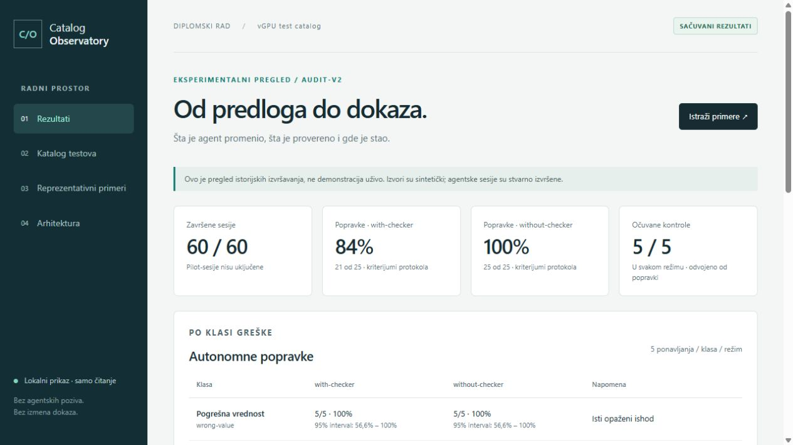

# Lokalni dashboard — Catalog Observatory



Snimak prikazuje lokalni dashboard sa učitanim dokazima, ne novo agentsko izvršavanje.

Dashboard vizuelno predstavlja već postojeći katalog, tri reprezentativne
sesije, korigovane rezultate i arhitekturu. Koristi Python standardnu biblioteku
za HTTP server i običan HTML/CSS/JavaScript. Nema novih zavisnosti, naloga,
baze podataka, CDN resursa ni spoljnog hostovanja.

## Pokretanje

Iz korena repozitorijuma:

```powershell
.venv\Scripts\python.exe tools\run_dashboard.py
```

Otvori `http://127.0.0.1:8765` u browser-u. Terminal ostaje otvoren dok traje
prikaz. Za zaustavljanje pritisni Ctrl+C. Ako je port zauzet:

```powershell
.venv\Scripts\python.exe tools\run_dashboard.py --port 8766
```

Tada otvori `http://127.0.0.1:8766`. Nije dovoljno direktno otvoriti index.html:
JavaScript dobija podatke sa lokalnog `/api/data` endpoint-a.

## Ekrani

1. **Rezultati:** 60 završenih sesija, stope popravke, tabela pet klasa,
   Wilson intervali, odvojene kontrole, tumačenje zaustavljanja i poreklo ocena.
2. **Katalog testova:** pretraga TC/GPU/opisa, izvedene vrednosti, Purpose,
   Notes, Summary i JSON provenijencija. Katalog je učitan pri pokretanju
   servera; time nije izvršena nova checker provera.
3. **Reprezentativni primeri:** izbor uspešne popravke, ljudskog pregleda i
   očuvanog kataloga; diff ubrizgavanja i popravke; odlomci ili ceo ulaz/izlaz;
   početni/završni evaluatorski JSON, agentska poruka i ocena sa auditom.
4. **Arhitektura:** slike održavanja i odvojenog eksperimentalnog/CI toka.
5. **Sve sesije i parovi:** 60 završenih sesija, filteri po grupi, režimu,
   klasi, ishodu i identifikatoru. Dugme Uporedi ili izbor para otvara oba
   režima istog kvara/ponavljanja, bez obzira na filter liste. Prikazani su
   ciljni odlomci, diff celog kataloga, završne ocene, hash-evi i izveštaji.

Panel **Šta je provereno?** odvojeno prikazuje validnost kataloga, zaštićena
polja, scope, MCP dokaze, broj agentskih provera, audit i završetak sesije.
Prikazuje već sačuvane ocene, ne novu validaciju. Nepoznati kriterijumi se ne
predstavljaju kao uspešni. Zbirni brojevi i napomene u webu izvode se iz podataka.

Ovo je **pregled istorijskih dokaza**, ne izvršavanje agenta uživo. Nema dugmeta
za nove eksperimente ili popravku kataloga. Početni i završni evaluatorski
izveštaji nisu broj agentskih poziva checker-a. Validnost izlaznog kataloga i
uspeh kompletne sesije predstavljeni su kao različite činjenice.

## Podaci i granice

Dashboard koristi prenosive, verzionisane pakete u `docs/evidence/`: `examples-v1`,
`results-v1` i `architecture-v1`, kao i trenutni `catalog/test_catalog.md` i
metapodatke iz `dataset/manifest.json`. Ne zahteva Git-ignored raw arhivu.
Detalji svih završenih sesija izvezeni su u `docs/evidence/sessions-v1/`.
Njihov manifest beleži hash-eve izvornih dokaza i generatora. Izvoz se obavlja
skriptom `tools/export_session_evidence.py`; originalna arhiva nije promenjena.
Paket ne uključuje pristupne podatke, komandne logove, runtime ili kompletne
agentske transkripte. Za kontrole je prikazan samo TC-001 kao ilustrativan
odlomak, ali diff i hash-evi odnose se na cele kataloge. Jedan infrastrukturni
prekid je sačuvan u originalnoj zbirci i brojčanom sažetku, ne među 60 završenih
sesija. Pilot-sesije ostaju isključene.
Pri pokretanju proverava hash-eve izvezenih dokaza i ponovo izračunava zbirnu
analizu iz sačuvanih ocena. Originalni rezultati nisu prepisani i nema novih
agentskih ili checker poziva. Eksperimentalni izvori su sintetički; ne treba
ih opisivati kao stvarna izvršavanja vGPU workload skripti.

Server sluša samo na `127.0.0.1`. Rute su eksplicitno dozvoljene; ne služi
repozitorijum kao statički direktorijum i ne prihvata putanje od korisnika.
Nema write API-ja, komandi, CORS dozvola niti renderovanja dokaza kao aktivnog
HTML-a. Tekstovi iz kataloga i poruke agenta prikazuju se pomoću `textContent`.
Uvedeni su CSP, no-store i nosniff header-i i provera lokalnog Host header-a.
Ovo je lokalni demonstracioni server, ne produkcioni servis sa autentikacijom;
nemoj ga izlagati mreži preko tunela ili reverse proxy-ja.

Ako nedostaje paket ili hash ne odgovara, pokretanje se zaustavlja umesto
prikazivanja neproverenih dokaza. Posle promene lokalnog kataloga restartovati
server za novu učitanu kopiju. Ta promena ne ažurira istorijske ocene.

## Predlog demonstracije na odbrani

Počni od rezultata, objasni korekciju auditora i ograničenja. Zatim otvori
uspešnu popravku i pokaži uklanjanje polja agent_confidence iz Markdown-a i
JSON-a. Pređi na ljudski pregled: katalog je nevalidan i neizmenjen, checker
nije pozvan. Završi čistom kontrolom sa jednakim hash-evima i bez izmena.
Kroz arhitekturu objasni zašto nezavisna završna provera postoji u oba režima.

Ovaj web sloj je dodat nakon zamrznutog eksperimenta i služi prezentaciji.
Nije nova eksperimentalna intervencija niti razlog za ponavljanje serije.

## Provera prve verzije (2026-10-29)

U browser-u su provereni početni prikaz, prelazak na primere, uspešna popravka,
zahtev za ljudski pregled i kontrola, pretraga TC-010 i njegov insufficient-data
prikaz, kao i učitavanje oba arhitekturna SVG-a. Na viewport-u širine 390 px
provereno je da nema horizontalnog preliva cele stranice. To nije potpuni
cross-browser ili accessibility audit. Automatski testovi proveravaju snapshot,
integritet paketa, HTTP rute i header-e, odbijanje write metoda i stranih Host
vrednosti i odsustvo pokretanja podprocesa pri učitavanju dokaza.

## Provera dopune sa sesijama

Dodati su Node testovi čistih pravila filtera/parova/kriterijuma i DOM contract
testovi koji izvršavaju stvarni app.js uz mali testni DOM. Proveravaju promenu
filtera, poništavanje, prazne rezultate, izbor para, kriterijume i pretragu
kataloga. To nisu punopravni headless-browser E2E testovi. Pytest ih pokreće kada
je Node dostupan; bez Node-a taj test se jasno preskače. Nema novih npm paketa.
U stvarnom browser-u provereni su učitavanje svih sesija, filter neuspeha i
par broken-format-r02 sa različitim ishodima i sedam kriterijuma po režimu.
Mobilna širina 390 px proverena je bez horizontalnog preliva cele stranice;
široka tabela ima svoj horizontalni scroll. Izvoz svih sesija je nov paket,
ne promena originalnog eksperimentalnog skupa niti naknadno prikupljanje.
