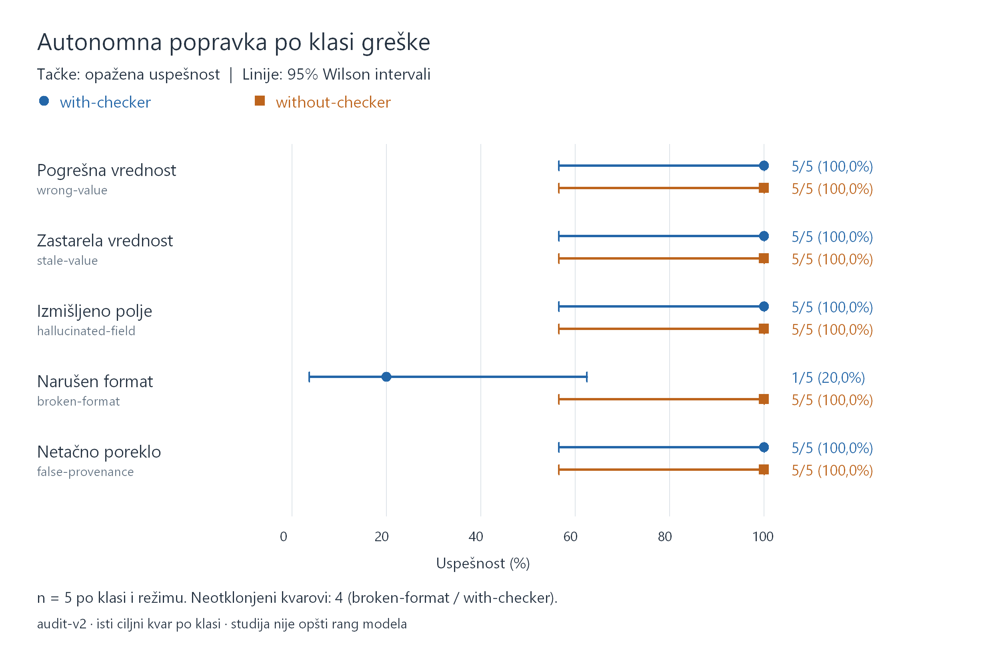
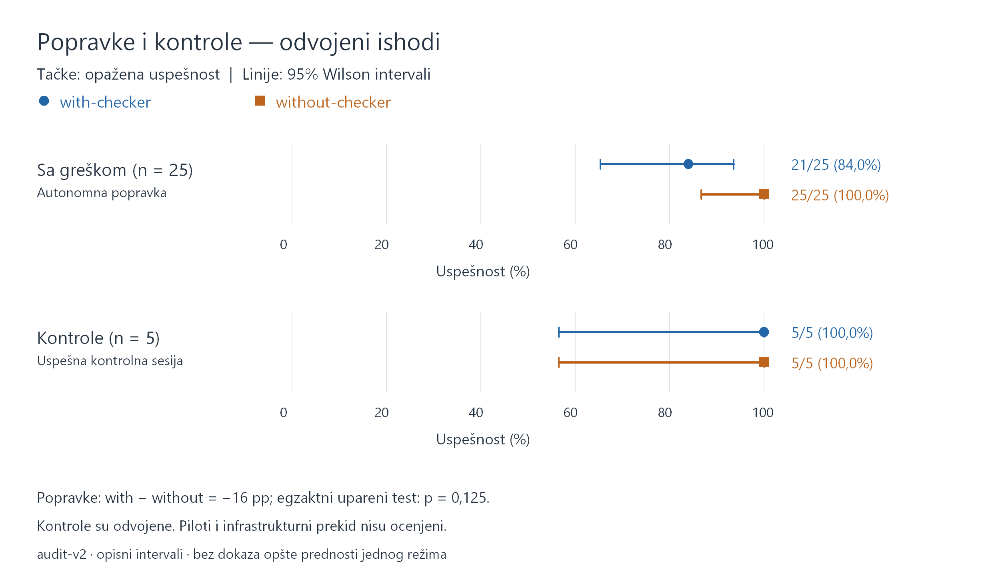

# Tabele, grafikoni i tumačenje rezultata za diplomski rad

Ovaj materijal je pripremljen iz korigovanih ocena `audit-v2` protokola
`codex-agent-eval-1`. Brojevi su ponovo izračunati iz pojedinačnih sačuvanih
ocena i upoređeni sa korigovanim zbirnim izveštajem. Nisu pokretane nove
agentske sesije. Pilot-pokretanja i jedan prekinuti pokušaj nisu uključeni u
imenioce stopa uspešnosti.

## Pripremljeni materijal

- [Četiri tabele](evidence/results-v1/tables.md): rezultati po klasi, zbirne
  popravke, odvojene kontrole i upareni ishodi.
- Grafikon po klasi: [PNG](evidence/results-v1/by-class.png) za ubacivanje u rad
  i [SVG](evidence/results-v1/by-class.svg) za vektorski prikaz.
- Zbirni grafikon sa odvojenim kontrolama:
  [PNG](evidence/results-v1/overall-and-controls.png) i
  [SVG](evidence/results-v1/overall-and-controls.svg).
- [Podaci](evidence/results-v1/data.json): prenosiva kopija minimalnih ocena
  svih pokušaja, zbirnih rezultata, konfiguracije i hash-eva izvora.
- [Manifest](evidence/results-v1/manifest.json): hash-evi izvornih podataka,
  koda generatora i izrađenih artefakata.

PNG slike imaju dvostruku rezoluciju u odnosu na SVG koordinatni sistem i
oznaku 300 dpi. Za rad ih ubaciti kao sliku, a ne kao screenshot stranice.
Fontovi mogu uticati na rasterizaciju na drugom računaru; izvorni SVG i podaci
ostaju prenosivi. Grafikoni koriste boju i različite oblike markera za režime.

## 1. Eksperimentalni uzorak i kriterijum uspeha — predlog teksta

Eksperimentalna serija sadrži 60 završenih agentskih sesija. Pet klasa grešaka
ispitano je kroz pet uparenih ponavljanja po klasi, pri čemu je svaki par
obuhvatio režime with-checker i without-checker. Time je dobijeno 50 sesija sa
ubačenom greškom. Dodatnih deset sesija čini pet uparenih kontrola bez ubačene
greške. Svaka klasa koristi jedan fiksni ciljni test i isti tip ubrizganog
kvara; ponavljanja se odnose na nova izvršavanja agenta, ne na različite
nasumično odabrane kvarove.

Uspešna autonomna popravka zahteva ispravan završni katalog, očuvana ljudski
pisana polja Purpose i Notes, poštovanje granice dozvoljenih izmena i
proceduralnih zahteva protokola. Zato ispravan završni katalog sam za sebe nije
dovoljan dokaz potpunog uspeha sesije. Kontrole se ocenjuju i prikazuju odvojeno
od slučajeva sa greškom, bez njihovog sabiranja u zajedničku stopu popravke.

## 2. Tabela rezultata po klasi — predlog teksta

Tabela 1 prikazuje korigovane rezultate po klasi greške. Za pogrešnu vrednost,
zastarelu vrednost, izmišljeno polje i netačno poreklo oba režima ostvarila su
uspeh u svih pet ponavljanja. Razlika je zabeležena kod narušenog formata:
with-checker ima jednu uspešnu autonomnu popravku od pet, a without-checker
pet od pet. U preostala četiri with-checker slučaja agent je ostavio neispravan
katalog neizmenjen i zatražio ljudski pregled.

Uz opažene stope prikazani su 95% Wilson intervali. Čak i rezultat 5/5 ima
interval približno 56,6–100%, što ukazuje na ograničenu preciznost procene iz
pet ponavljanja. Intervali opisuju pojedinačne stope u ovom kontrolisanom
postupku; ne predstavljaju interval razlike između režima niti rešavaju pitanje
reprezentativnosti izabranih kvarova.

Predlog potpisa za sliku:

> Slika X. Opažena uspešnost autonomne popravke po klasi greške i režimu rada.
> Markeri prikazuju stopu uspeha, a horizontalne linije 95% Wilson intervale;
> n = 5 po klasi i režimu. Prikazano je korigovano ocenjivanje audit-v2.



## 3. Zbirni rezultati popravke i kontrole — predlog teksta

Zbirno, with-checker ostvaruje 21/25 uspešnih popravki (84,0%), uz 95% Wilson
interval 65,3–93,6%. Without-checker ostvaruje 25/25 (100,0%), uz interval
86,7–100%. Za kontrole je rezultat 5/5 u oba režima, uz interval 56,6–100%.
Kontrolni katalozi ostali su neizmenjeni. Veća opažena stopa u režimu
without-checker ne predstavlja sama po sebi dokaz njegove opšte prednosti.

Predlog potpisa za sliku:

> Slika Y. Zbirni ishodi za slučajeve sa greškom (n = 25 po režimu) i odvojene
> kontrolne sesije (n = 5 po režimu). Linije predstavljaju 95% Wilson intervale
> pojedinačnih stopa. Kontrole nisu uključene u zbirnu stopu popravke.



## 4. Upareno poređenje — predlog teksta

Od 25 parova sa greškom, oba režima su uspešna u 21 paru. U četiri para
uspešan je samo without-checker, dok nema parova u kojima je uspešan samo
with-checker ili su oba režima neuspešna. Razlika opaženih stopa, definisana
kao with-checker minus without-checker, iznosi −16 procentnih poena.
Egzaktni dvostrani upareni binomni test nad nesaglasnim parovima daje
p = 0,125. Ovaj rezultat ne podržava tvrdnju o statistički potvrđenoj prednosti
jednog režima na uobičajenom nivou od 0,05, ali nije ni dokaz jednakosti režima.
Poređenje je eksplorativno.

U kontrolnoj grupi svih pet parova uspešno je u oba režima. Nema nesaglasnih
parova, pa se vrednost p = 1 u izveštaju tumači kao konvencija u odsustvu
razlika, a ne kao potvrda ekvivalentnosti.

## 5. Uloga zahteva za ljudski pregled — predlog teksta

Sva četiri neotklonjena kvara pripadaju klasi broken-format u režimu
with-checker. Agent je prijavio potrebu za ljudskim pregledom i nije pozvao
checker. Zamrznuti skill navodi da strukturne greške zahtevaju ljudski pregled,
što stvara napetost između konzervativnog uputstva i cilja autonomne popravke
ove klase. Takvo zaustavljanje ostaje neuspeh prema definisanom kriterijumu
popravke, ali nije dokaz da je checker pogrešno odbio ispravnu izmenu niti da
je njegov algoritam izazvao neuspeh. Izmereno je ukupno ponašanje agenta sa
datim uputstvima, ne izolovan uzročni efekat same provere.

Konkretan slučaj, ulazni i izlazni katalog i poruka agenta dostupni su u
[reprezentativnim primerima](representative-examples.md).

## 6. Korekcija auditora i ograničenja — predlog teksta

Pri naknadnom pregledu otkriveno je da je prvobitni auditor u sedam sesija
pogrešno protumačio negativne globove u komandi rg --files kao direktno čitanje
zabranjenih izvora. Korigovana je samo ta tekstualna klasifikacija, bez promene
kriterijuma uspeha, izlaznih kataloga ili ponovnog pokretanja sesija. Originalne
ocene i dokazi ostali su sačuvani, a promenjene ocene dokumentovane u reviziji
audit-v2. Tabele i slike u ovom poglavlju koriste tu korigovanu reviziju.

Ograničenja uključuju mali broj ponavljanja, jedan sintetički skup podataka,
jedan model i konfiguraciju, isti ciljni kvar po klasi i nedostupan seed modela.
Seed rasporeda ne garantuje identične odgovore modela. Opisni binomni intervali
i eksplorativni test pretpostavljaju odgovarajuće ponašanje ponavljanja; nova
sesija sama po sebi ne dokazuje statističku nezavisnost. Izbor fiksnih kvarova
posebno ograničava generalizaciju na druge projekte i populaciju mogućih
kvarova. Ocenjena je usklađenost sa definisanim ugovorom i procedurom, ne opšta
semantička ispravnost slobodnog teksta.

## Reprodukcija bez novih eksperimenata

Tabele i SVG grafikoni mogu se ponovo izraditi iz prenosivih podataka:

```powershell
.venv\Scripts\python.exe tools\build_results_figures.py --data docs/evidence/results-v1/data.json --destination .tmp/results-reproduced
```

Na Windows-u dodati `--png` za PNG. Koriste se Python standardna biblioteka i
Windows GDI, bez instalacije novih paketa i promene sistemskih politika.
Postojeće odredište se ne prepisuje. Manifest navodi hash-eve izvora i izlaza.
Datoteke `*.drawing.json` opisuju tačne koordinate oba formata; nisu novi
eksperimentalni rezultati.
